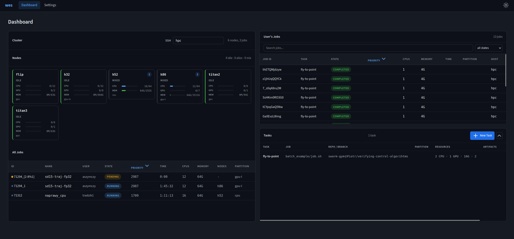

# WES - WUT Experiment Scheduler

WES is set of helper tools for scheduling and observing jobs on slurm from remote machine.



## Todo:

[x] WES cli - tool for launching jobs

[ ] WES sync - tool for syncing files with cluster


## Install

```bash
pip install -e ".[dev]"
```

or
```bash
uv sync
```

## Run

```bash
wes launch task.wes     # run tasks from a config
wes sync --ssh hpc      # continuously sync job status
```

Or via Makefile: `make run`, `make test`, `make check`.

## WES tasks

A `.wes` file is YAML. Each task clones a repo and runs a job:

```yaml
sequence:
  - my_task:
      git_url: ssh://git@host/user/repo.git
      branch: main
      ssh: hpc
      pre: scripts/pre.sh
      job: scripts/job.sh
      artifacts:
        - results
      progress-artifacts:
        - results/progress.png
      cpus: "4"
      gpus: "1"
      memory: 16G
```

See `task.wes` for a working example.

`artifacts` are pulled when the job finishes. `progress-artifacts` are files
refreshed by WES Hub while the Slurm job is pending or running; image files are
shown as thumbnails in the job detail.

## Job status on the server

Every scheduled task writes a `wes.status` YAML file into its remote job directory
(`<task>/<namespace>/wes.status`), updated by `wes sync` whenever the SLURM state changes:

```bash
ssh hpc 'cat <task>/<namespace>/wes.status'
```

```
task: ncpu_alu
namespace: ncpu_alu_20260922101030_ab12
job_name: ncpu_alu_ncpu_alu_20260922101030_ab12
ssh: hpc
state: RUNNING
updated: '2026-09-22 10:15:02'
job_id: '4242'
node: h86
partition: gpu
```

States: `PENDING` (submitted), `RUNNING`, `COMPLETED`, `FAILED`, `CANCELLED`.
Failures before submission (clone, pre-script, `sbatch`) are recorded in `message`.
The file is removed together with the job directory when `cleanup: True`.

Optional git credentials go in a `.env` file (see `.env.example`).
